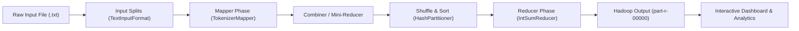

# Word Frequency Counter using Apache Hadoop MapReduce

An academic Big Data analytics platform demonstrating the **Apache Hadoop MapReduce** programming model with a modern, high-performance web dashboard.

---

## 1. System Architecture



The system demonstrates the complete distributed data processing pipeline:
$$\text{Input Text File} \longrightarrow \text{Input Splitting} \longrightarrow \text{Mapper} \longrightarrow \text{Shuffle \& Sort} \longrightarrow \text{Reducer} \longrightarrow \text{Word Frequency Output}$$

---

## 2. Technology Stack

### Backend
- **Java**: OpenJDK 17 LTS
- **Apache Hadoop MapReduce**: v3.3.6 Core, Client, Common (`org.apache.hadoop.mapreduce.Job`, `Mapper`, `Reducer`, `FileInputFormat`, `FileOutputFormat`)
- **Spring Boot**: v3.2.5 (Embedded Tomcat, REST API, Multipart File Handling)
- **Apache Commons IO**: v2.15.1
- **Build Tool**: Apache Maven 3.9.6

### Frontend
- **Framework**: React 19 with TypeScript
- **Bundler**: Vite
- **Styling**: Tailwind CSS (Tailwind v4 with dark navy Big Data palette `#080b16`, `#11162b`, `#1e294b`)
- **Charts**: Recharts (Horizontal Bar Chart for Top 10 words, Pie/Donut Chart for frequency distribution)
- **Icons**: Lucide React

---

## 3. MapReduce Implementation Details

### A. Mapper Class: `TokenizerMapper.java`
- Extends `org.apache.hadoop.mapreduce.Mapper<LongWritable, Text, Text, IntWritable>`
- **KeyIn**: `LongWritable` (byte offset of the line in the split)
- **ValueIn**: `Text` (line content)
- **KeyOut**: `Text` (individual word token)
- **ValueOut**: `IntWritable` (constant value of `1`)
- Features: Case-normalization, configurable punctuation removal, stop-word filtering.

### B. Reducer Class: `IntSumReducer.java`
- Extends `org.apache.hadoop.mapreduce.Reducer<Text, IntWritable, Text, IntWritable>`
- Also acts as the **Combiner** on the Mapper node to minimize network shuffle overhead.
- **KeyIn**: `Text` (unique word)
- **ValueIn**: `Iterable<IntWritable>` (collection of 1s)
- **KeyOut**: `Text` (unique word)
- **ValueOut**: `IntWritable` (total count sum)

### C. Job Driver: `HadoopJobDriver.java`
- Configures `Job.getInstance(conf, "word count")`
- Sets `FileInputFormat` and `FileOutputFormat`
- Manages output artifacts: `part-r-00000` and `_SUCCESS` marker.

---

## 4. Key Application Features

1. **Analytics Dashboard**:
   - 4 Summary Cards: *Total Words*, *Unique Words*, *Most Frequent Word*, *Processing Time*.
   - Interactive Recharts Bar Chart (Top 10 Words by frequency).
   - Key Density Distribution Donut Chart.
   - Live Hadoop Framework Counters (`MAP_INPUT_RECORDS`, `MAP_OUTPUT_RECORDS`, `REDUCE_INPUT_GROUPS`, `SPLIT_RAW_BYTES`).
   - Hadoop CLI Console Log stream.

2. **Text Analysis Page**:
   - **File Upload**: Drag-and-drop `.txt` files with size validation and upload progress.
   - **Text Input**: Multi-line editor with live character, word, and line counters.
   - Pre-loaded academic sample texts (Big Data Overview, Distributed Systems, Gettysburg Address).
   - Processing options: Case sensitivity, punctuation stripping, stop-word filtering, sorting, and split size tuning.

3. **MapReduce Workflow Visualizer**:
   - Interactive visualization of all 5 stages: Splits $\to$ Mapper $\to$ Shuffle & Sort $\to$ Reducer $\to$ Output.
   - Search filter to highlight any word's journey through each stage.

4. **Results & Export**:
   - Paginated, searchable, and sortable word frequency table with visual density bars.
   - Export options: **CSV**, **JSON**, and raw Hadoop **`part-r-00000`** download.
   - Built-in raw part file viewer with one-click clipboard copy.

5. **Analysis History**:
   - Persistent history of previous MapReduce runs with execution times, status badges, and quick-load inspect capabilities.

6. **College Viva & Presentation Guide**:
   - Comprehensive Q&A preparation covering Data Locality, Combiners, HDFS vs MapReduce, and Writable serialization.

7. **Cluster Configuration & Settings**:
   - Toggle between Hadoop Mode and Demo Mode.
   - FileSystem URI configuration (`file:///` or `hdfs://`).
   - Environment diagnostic metrics (CPU cores, JVM heap, engine versions).

---

## 5. How to Run the Application

### Option A: One-Click Windows Launchers
- Double click `run-all.bat` to launch both Backend and Frontend and open your browser automatically.
- Or start independently:
  - `run-backend.bat`: Launches Spring Boot on `http://localhost:8080`.
  - `run-frontend.bat`: Launches Vite React on `http://localhost:5173`.

### Option B: Terminal Commands
#### 1. Start Backend:
```powershell
cd backend
java -jar target\word-frequency-mapreduce-1.0.0.jar
```
*(Backend runs on `http://localhost:8080`)*

#### 2. Start Frontend:
```powershell
cd frontend
npm.cmd run dev
```
*(Frontend runs on `http://localhost:5173`)*

---

## 6. REST API Endpoints

| Method | Endpoint | Description |
|---|---|---|
| `POST` | `/api/analyze/text` | Runs MapReduce on raw text payload |
| `POST` | `/api/analyze/file` | Runs MapReduce on multipart uploaded `.txt` file |
| `GET` | `/api/jobs` | Retrieves history of all executed jobs |
| `GET` | `/api/jobs/{id}` | Retrieves full result object for a specific job |
| `GET` | `/api/jobs/{id}/export/csv` | Downloads CSV export of word frequencies |
| `GET` | `/api/jobs/{id}/export/json` | Downloads JSON export of word frequencies |
| `GET` | `/api/jobs/{id}/export/part` | Downloads standard Hadoop `part-r-00000` file |
| `GET` | `/api/status` | System health, JVM memory, and Hadoop engine info |
| `GET` | `/api/samples` | Pre-loaded academic text samples |

---

## 7. College Viva Defense Cheatsheet

- **Q: Why use MapReduce instead of a simple Java HashMap?**  
  *A:* A Java HashMap runs on a single machine and is bounded by RAM (out-of-memory on big data). MapReduce partitions datasets across hundreds of machines, leveraging data locality on HDFS to process terabytes in parallel.

- **Q: What is the purpose of the Combiner in Word Count?**  
  *A:* The Combiner is a local mini-reducer running directly on the Mapper node. It sums duplicate tokens before they cross the network, dramatically reducing network bandwidth overhead during the Shuffle phase.

- **Q: What are Hadoop Writables?**  
  *A:* `Text`, `IntWritable`, and `LongWritable` provide compact, high-speed binary serialization without Java reflection overhead.
